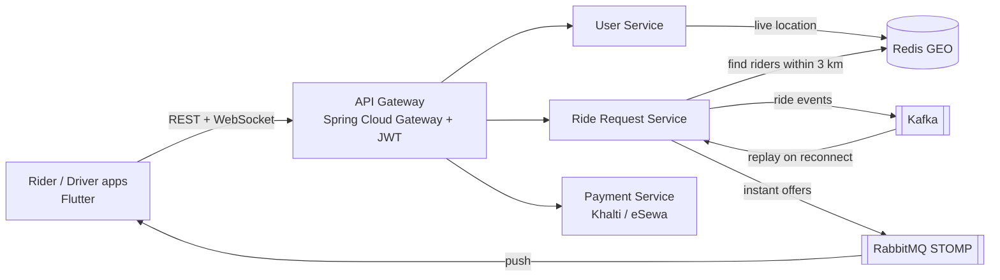

# Hi, I'm Sandip Chapagain 👋

**Backend & DevOps engineer for startups.** I design, build and run production systems end to end: Java/Spring Boot microservices, event-driven architecture, Kubernetes, and Flutter mobile apps.

CTO of **Tufan** (ride-sharing, Nepal) · CTO of **KRYZOX**, **GigFine** and **GigsRentals** · Founder of **[A1 IT Innovation](https://www.a1itinnovation.com.np)**

📍 Kathmandu, Nepal · 🌍 Working remotely with teams worldwide

---

## 🚀 What I've built (in production)

| Product | What it is | My role |
|---|---|---|
| **Tufan** | Ride-sharing & delivery: car, comfort, bike, scheduled rides, cargo and parcel, free in-app calls, smart safety system | CTO: architecture, backend, infra, Flutter apps |
| **KRYZOX** | Esports tournament platform for PUBG Mobile, BGMI and Free Fire with entry fees and prize money | CTO |
| **GigFine** | Platform to report problems with ride-sharing and delivery apps in Nepal | CTO |
| **GigsRentals** | Rental marketplace for cars, bikes and houses | CTO |
| **T-Meet** | White-label video conferencing for online classes and meetings | Built and deployed |
| **A1 Scanner** | Offline document scanner app | Product owner |

## 🏗️ System design: real-time ride dispatch (Tufan)

- **Redis GEO** keeps live rider locations, so nearby riders are found in milliseconds
- **Kafka** stores ride events durably; a rider who lost network gets the offer again on reconnect
- **RabbitMQ (STOMP/WebSocket)** pushes offers instantly; once one rider accepts, the offer is cleared for everyone else
- **Self-hosted maps** (OSRM, Nominatim, Valhalla) with zero-downtime blue-green data refresh

## ⚙️ How I ship

- **Kubernetes** on VPS (kubeadm, containerd, Flannel), multi-node, one cluster per product
- **GitOps** with ArgoCD · **CI/CD** with Jenkins (cut deploy time from ~30 min to ~3 min)
- **Observability** with Prometheus, Grafana and Loki
- **Edge**: Cloudflare, cert-manager, Nginx

## 🧰 Stack

## 🤝 Work with me

I help startups and product teams to:

- Build or scale a **Spring Boot / microservices backend**
- Set up or fix **Kubernetes, Docker and CI/CD**
- Build **cross-platform mobile apps** with Flutter
- Launch a **white-label ride-sharing, delivery or video-conferencing platform** in weeks, not months

Most client code is private, so I'm happy to walk you through architecture and live demos on a call.

